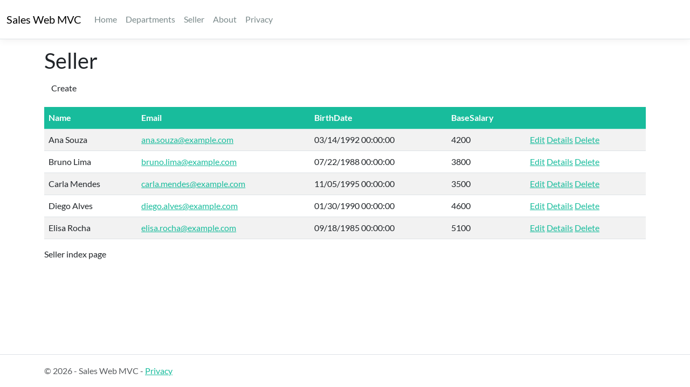
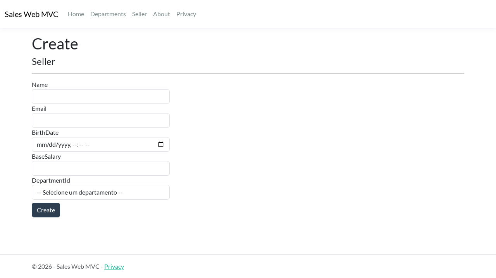
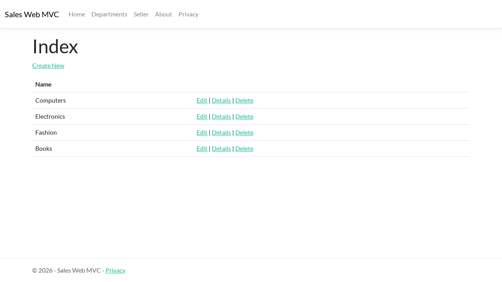

# Sales Web MVC

Aplicação web para gerenciamento de **departamentos** e **vendedores**, desenvolvida com ASP.NET Core MVC, Entity Framework Core e MySQL.

## Tecnologias

- .NET 8 / ASP.NET Core MVC (Razor Views)
- Entity Framework Core 9 + Pomelo (MySQL)
- MySQL 8
- Bootstrap (tema Flatly)
- Docker / Docker Compose

## Funcionalidades

- CRUD de departamentos
- CRUD de vendedores com seleção de departamento
- Validação de formulários (Data Annotations)
- Camada de serviços com exceções personalizadas (`NotFoundException`, `DbConcurrencyException`)
- Página de erro customizada
- Migrations aplicadas automaticamente na inicialização, com departamentos iniciais

## Screenshots

**Lista de vendedores**



**Cadastro de vendedor**



**Departamentos**



## Como rodar com Docker

Pré-requisito: [Docker](https://www.docker.com/) instalado.

```bash
cp .env.example .env
docker compose up -d --build
```

Acesse: http://localhost:8080

Para parar:

```bash
docker compose down        # mantém os dados
docker compose down -v     # remove também o volume do MySQL
```

## Como rodar localmente (sem Docker para a aplicação)

Pré-requisito: .NET 8 SDK.

1. Suba só o banco: `docker compose up -d mysql`
2. Copie `MyProject/appsettings.Development.example.json` para `MyProject/appsettings.Development.json` e ajuste a connection string com os dados do `.env`.
3. Rode:

```bash
dotnet run --project MyProject
```

## Migrations

O `MyProjectContextFactory` lê as variáveis `MYSQL_*` do arquivo `.env`:

```bash
dotnet ef migrations add NomeDaMigration --project MyProject
dotnet ef database update --project MyProject
```

## Estrutura

```
.
├── Dockerfile
├── docker-compose.yml
├── .env.example
├── MyProject.slnx
└── MyProject/
    ├── Controllers/     # Home, Departments, Seller
    ├── Data/            # DbContext e factory de design-time
    ├── Migrations/
    ├── Models/          # Department, Seller, SalesRecord, ViewModels
    ├── Services/        # SellerService, DepartmentService, Exceptions
    ├── Views/
    └── wwwroot/
```

## Autor

Ricardo Pereira — [rdata.site](https://rdata.site)
